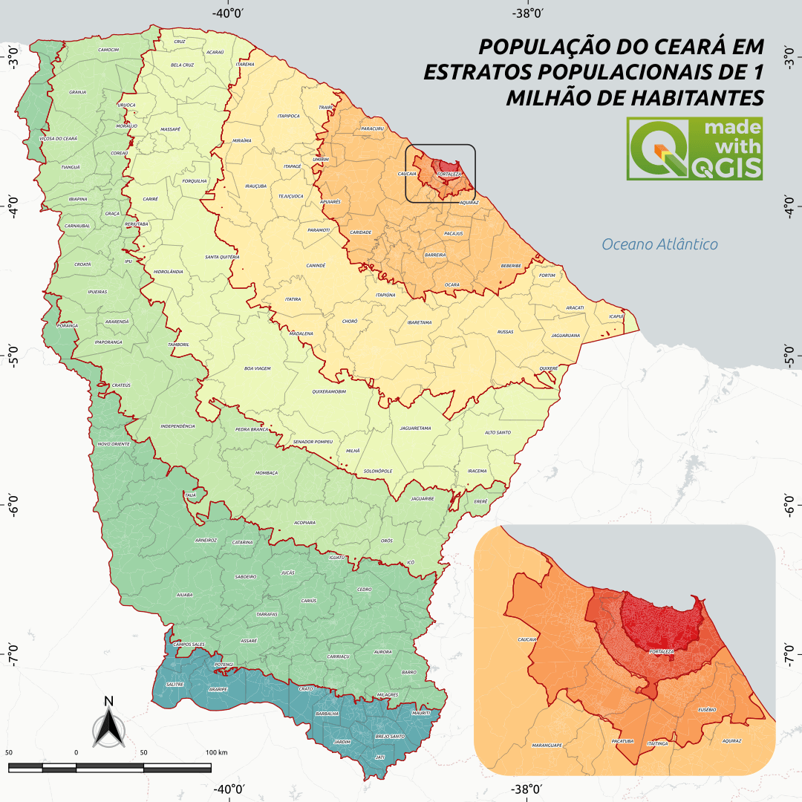
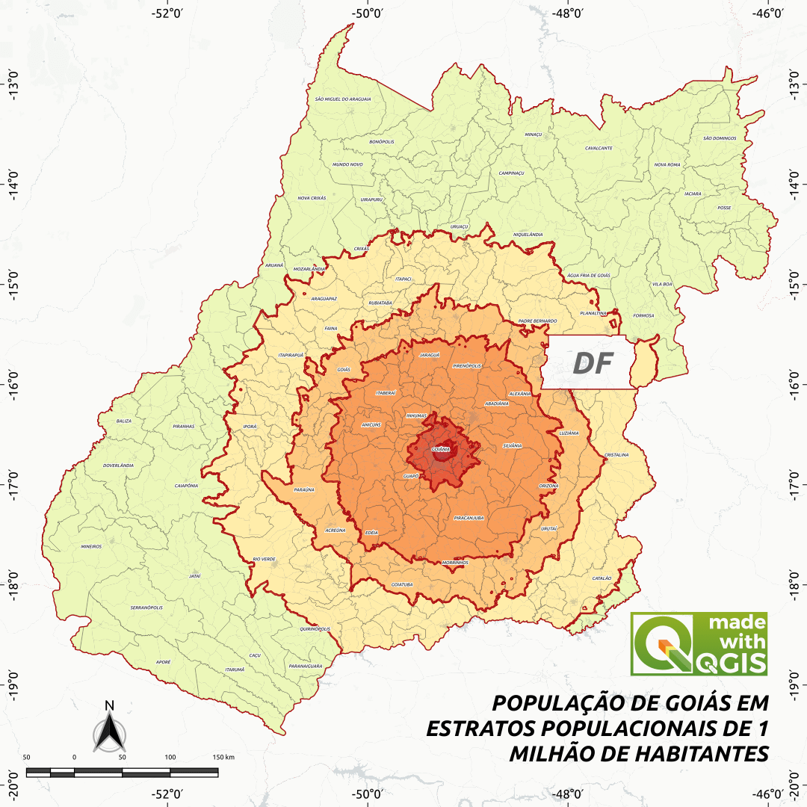
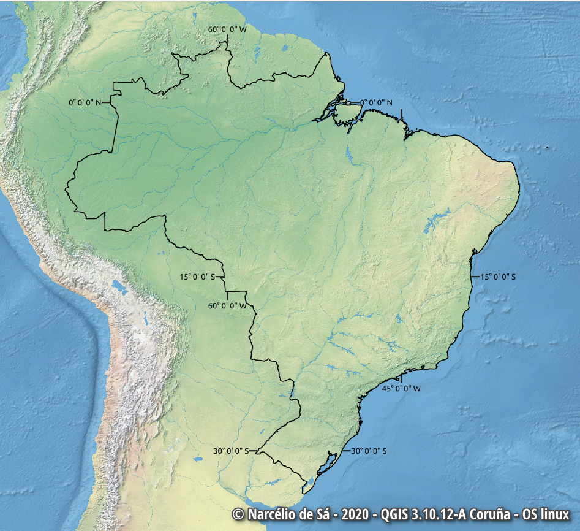
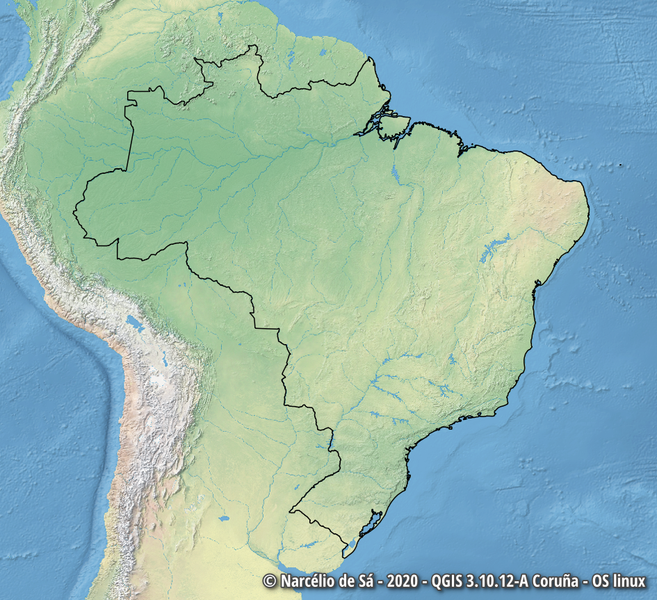
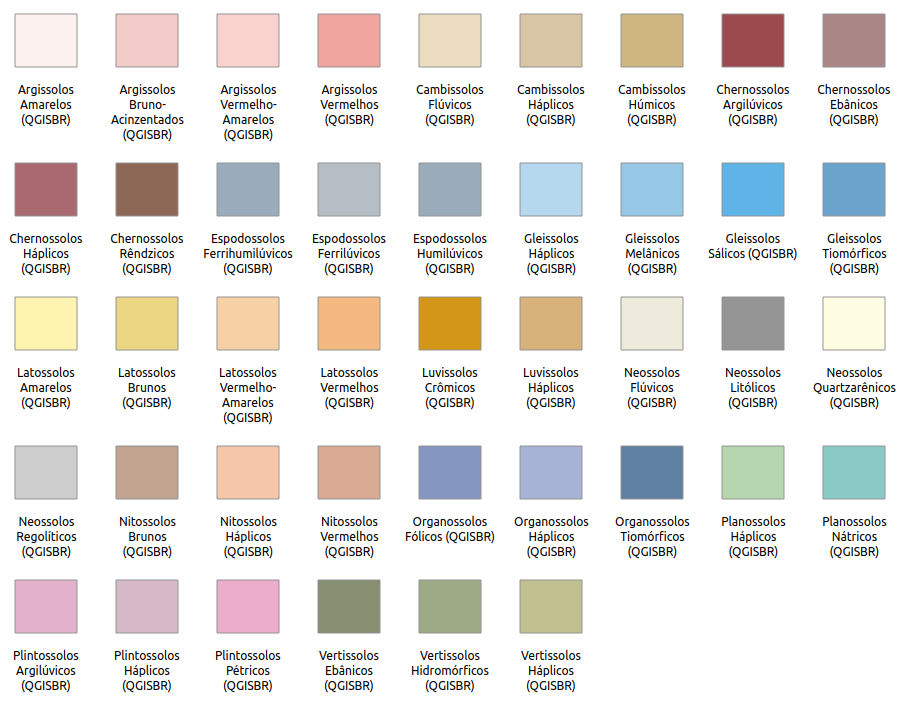
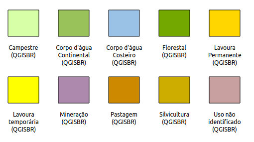

  

# QGISBR — Repositório de Recursos da Comunidade

Repositório oficial e colaborativo da comunidade **QGIS Brasil**, reunindo modelos de processamento, simbologias padronizadas de órgãos oficiais brasileiros, estilos e scripts prontos para uso por meio do complemento [**QGIS Resource Sharing**](https://plugins.qgis.org/plugins/qgis_resource_sharing/).

---

## Como usar no QGIS

1. Abra o **QGIS** e acesse **Complementos > Gerenciar e Instalar Complementos...**
2. Pesquise por **QGIS Resource Sharing** e clique em **Instalar complemento**.
3. Acesse o plugin em **Complementos > Resource Sharing > Resource Sharing**.
4. Vá até a aba **Settings** (Configurações) e clique em **Add** (Adicionar).
5. Preencha os campos com:
   - **Name:** `QGIS Brasil`
   - **URL:** `https://github.com/qgisbr/QGISBR-Resources.git`
6. Retorne à aba **All** (Todos), selecione a coleção desejada e clique em **Install** (Instalar). Os modelos e estilos ficarão disponíveis automaticamente na **Caixa de Ferramentas de Processamento** e no **Gerenciador de Estilos**.

---

## Resumo das Coleções

| Coleção | Categoria | Pasta |
| :--- | :--- | :--- |
| **Split Population** | Modelo | [`collections/split_population`](https://github.com/qgisbr/QGISBR-Resources/tree/main/collections/split_population) |
| **Grid Polygon** | Modelo | [`collections/grid_polygon`](https://github.com/qgisbr/QGISBR-Resources/tree/main/collections/grid_polygon) |
| **Sistema Brasileiro de Classificação de Solos (SiBCS)** | Simbologia | [`collections/classificacao_solos_embrapa`](https://github.com/qgisbr/QGISBR-Resources/tree/main/collections/classificacao_solos_embrapa) |
| **Sistema de Classificação de Uso da Terra (SCUT)** | Simbologia | [`collections/sistema_classificacao_uso_terra_scut`](https://github.com/qgisbr/QGISBR-Resources/tree/main/collections/sistema_classificacao_uso_terra_scut) |
| **Mapeamento Geológico — CPRM** | Simbologia | [`collections/geologia_cprm`](https://github.com/qgisbr/QGISBR-Resources/tree/main/collections/geologia_cprm) |

---

## Detalhes e Pré-visualizações

### 1. [Split Population](https://github.com/qgisbr/QGISBR-Resources/tree/main/collections/split_population)
Modelo que agrupa dados censitários e populacionais com base em um valor de corte ou em um número definido de grupos.

| Exemplo — Ceará | Exemplo — Goiás |
| :---: | :---: |
|  |  |

---

### 2. [Grid Polygon](https://github.com/qgisbr/QGISBR-Resources/tree/main/collections/grid_polygon)
Modelo que cria uma grade de coordenadas ao redor de uma feição selecionada.

| Com Grade | Sem Grade |
| :---: | :---: |
|  |  |

---

### 3. [Simbologia do Sistema Brasileiro de Classificação de Solos (SiBCS)](https://github.com/qgisbr/QGISBR-Resources/tree/main/collections/classificacao_solos_embrapa)
Símbolos para elaboração de mapas pedológicos seguindo o **Sistema Brasileiro de Classificação de Solos (Embrapa Solos)**, com cores padronizadas definidas até o nível de Subordem.

---

### 4. [Simbologia do Sistema de Classificação de Uso da Terra (SCUT)](https://github.com/qgisbr/QGISBR-Resources/tree/main/collections/sistema_classificacao_uso_terra_scut)
Símbolos para classes de cobertura e uso da terra nos **Níveis I e II** do Sistema de Classificação de Uso da Terra (SCUT).

---

### 5. [Simbologia para Mapeamento Geológico — Serviço Geológico do Brasil (CPRM)](https://github.com/qgisbr/QGISBR-Resources/tree/main/collections/geologia_cprm)
Conjunto de símbolos cartográficos padronizados voltados ao mapeamento geológico oficial do **Serviço Geológico do Brasil (SGB/CPRM)**.

---

## Como Contribuir

Contribuições de novos modelos (`.model3`), estilos (`.xml`, `.qml`), scripts (`.py`) e paletas de cores são muito bem-vindas!

1. Consulte o nosso **[Guia de Contribuição (`CONTRIBUTING.md`)](./CONTRIBUTING.md)** para ver a estrutura exigida nas pastas e o modelo de arquivo `metadata.ini`.
2. Faça um **Fork** deste repositório, adicione sua coleção em `collections/` e atualize a lista acima.
3. Abra um **Pull Request** descrevendo o recurso adicionado.

---

## Licença e Contato

- Distribuído sob a licença **GNU General Public License v3.0 (GPL-3.0)**. Consulte o arquivo [`LICENSE`](./LICENSE) para mais detalhes.
- Dúvidas, sugestões ou problemas com algum recurso? Abra uma [**Issue**](https://github.com/qgisbr/QGISBR-Resources/issues) ou entre em contato pelo e-mail **qgisbrasil@gmail.com**.
